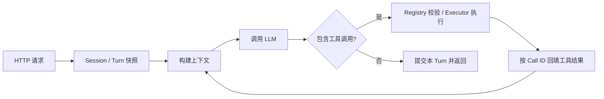

# mini-agent-go

从零实现的 Go Agent Runtime，核心执行循环不依赖任何现成 Agent 框架。模型通过 OpenAI-compatible Chat Completions / Tool Calling 自主决定直接回答还是调用工具，运行时负责工具注册、参数校验、执行、结果回填、多轮循环与 Session 状态管理。

技术栈：Go 1.24（业务模块仅使用标准库）、React + TypeScript + Vite。前端静态产物由同一个 Go 进程同源提供，前后端打包为一个镜像、监听一个端口。

| 能力 | 当前实现 |
| --- | --- |
| Agent Loop | 直接回答与多步工具调用；单次响应可包含多个工具调用，按顺序执行 |
| 工具 | `calculator`、`mock_search`（固定数据集）、`todo_create` / `todo_list` / `todo_complete` |
| Session | 同会话串行、跨会话隔离与并发；状态仅保存在进程内存 |
| Context | 估算 Token 预算、近期窗口、规则化有损摘要；压缩默认关闭 |
| 运行保护 | 模型与工具调用预算、超时与取消、失败整轮回滚、按 Session / Run / Tool Call 关联的 JSON 日志 |
| Web UI | 多会话对话页、Markdown 渲染、深浅主题；完整回答返回后展示，不支持流式输出 |

## 环境要求

运行预构建镜像 `docker.cnb.cool/framework-station/mini-agent-go:latest`：

- Git、GNU Make、curl
- Docker Engine 或 Docker Desktop，包含 Compose v2
- 可用的 Docker daemon，以及拉取镜像、访问模型服务的网络

在本地用项目 Dockerfile 构建镜像：

- 上述环境
- 可访问 Docker Hub 与 npm registry，用于下载 Go / Node 基础镜像和前端依赖
- 宿主机无需安装 Go 或 Node.js，版本由多阶段 Dockerfile 提供

在宿主机直接修改、编译和调试源码：

- Go 1.24+
- Node.js 24 与 npm（仅前端开发和测试需要）
- `go test -race` 需要 C 工具链

可选开发容器：`docker.cnb.cool/arthur-cloud-native/jetbrains/goland:5.0.1`。它是可选的开发环境镜像，不是本项目的应用镜像；在其中开发仍需自行确保 Docker daemon 可用。

发布镜像目前只提供 `linux/amd64`。Apple Silicon 需要 Docker 的 AMD64 模拟支持，或改用本地构建。

## 快速开始

```bash
git clone https://cnb.cool/framework-station/mini-agent-go.git
cd mini-agent-go

make init
```

`make init` 会引导选择预构建镜像或从本地源码构建，并在缺少 `.env` 时按模板生成；已有 `.env` 不会被覆盖。

编辑生成的 `.env`，填写模型 API Key 与本服务的 HTTP Bearer Token：

- 默认使用作者已验收的腾讯云 TokenHub 与 `deepseek/deepseek-flash`。
- 其他支持 OpenAI Chat Completions 与 Tool Calling 的服务商同样可用，切换时需同步修改 BaseURL、Model 和 API Key。
- 没有合适的测试 Key 时，可以私下联系作者获取临时 TokenHub 凭据。
- HTTP Token 可用 `openssl rand -hex 32` 生成，它与模型 API Key 用途不同。

```bash
make up
```

启动成功后访问 **http://127.0.0.1:8080**。

`make up` 会按初始化时的选择拉取现成镜像或本地构建镜像，两种方式都只启动一个同时提供页面和 API 的应用容器，默认只绑定宿主机 `127.0.0.1:8080`。

## HTTP API

`/healthz` 免认证；`/v1/*` 需要 Bearer Token。浏览器页面通过同源 `/api/*` 调用，凭证由 Go 服务内部注入，不进入前端产物。

`.env` 不会自动成为当前 Shell 的环境变量。以下命令可直接复制执行，Token 由终端无回显读取：

```bash
curl -fsS http://127.0.0.1:8080/healthz
# {"status":"ok"}

printf 'HTTP Token: '; read -r -s TOKEN; printf '\n'
```

创建 Session，并复制返回的 `session_id`：

```bash
curl -fsS -X POST http://127.0.0.1:8080/v1/sessions \
  -H "Authorization: Bearer $TOKEN" \
  -H 'Content-Type: application/json' \
  -d '{}'
# {"session_id":"..."}

printf 'session_id: '; read -r SESSION_ID
```

用该 Session 发送消息，并继续追问：

```bash
curl -fsS -X POST http://127.0.0.1:8080/v1/chat \
  -H "Authorization: Bearer $TOKEN" \
  -H 'Content-Type: application/json' \
  -d "{\"session_id\":\"$SESSION_ID\",\"message\":\"请使用计算工具计算37乘以48\"}"

curl -fsS -X POST http://127.0.0.1:8080/v1/chat \
  -H "Authorization: Bearer $TOKEN" \
  -H 'Content-Type: application/json' \
  -d "{\"session_id\":\"$SESSION_ID\",\"message\":\"把刚才的结果加上24，请继续使用计算工具\"}"
```

响应为 JSON，包含 `status`、`reply`、`llm_calls` 与 `tool_calls`。在作者环境中，上述两轮分别得到 `1776` 与 `1800`；实际措辞和调用次数取决于模型。不同 `session_id` 的历史相互独立，服务重启后旧 Session 不再存在。

## 系统设计



Loop：每个请求取出 `session_id` 对应的 Turn 快照，把已提交历史与本轮消息构造成上下文后调用模型。模型返回文本与 `tool_calls`：没有工具调用且 `finish_reason` 为 `stop` 时，本轮结束并向调用方返回回复；存在工具调用时，运行时依次执行调用、按 `tool_call_id` 回填 `role=tool` 消息，再次调用模型，直到得到最终回答或用尽预算。

工具注册与 Schema：Registry 保存每个工具的名称、描述与 JSON Schema，调用模型时整体作为 `tools[]` 下发。模型只看到这些声明，是否调用完全由模型决定，没有基于关键词的硬编码路由，也没有独立的思维链解析器。

执行与校验：Executor 在执行前确认工具存在，并按 Schema 校验参数（必填字段、类型、枚举），随后在工具级超时内执行并隔离 panic。未知工具、参数非法、工具自身报错和工具超时都以 `IsError` 结果回填给模型，由模型决定下一步；panic 视为不可恢复的 `tool_failure`；同一 Run 内重复的 Call ID 直接拒绝，避免重复执行。

预算与失败：默认每次 Run 最多 8 次模型调用和 8 次工具调用，工具超时 30s，请求超时 60s，均可通过 `.env` 调整。超出预算、模型故障、输出被截断或上下文取消都会终止本次 Run 并返回固定错误码；该轮产生的消息、摘要和 Todo 修改整体丢弃，不写入 Session。

## Session、Context 与 Memory

Session 隔离：每个 `session_id` 对应一个 Turn 快照，包含消息、摘要与 Todo。同会话请求串行执行，不同会话可并发，彼此不可见。

上下文构建时机与顺序：每轮开始时取快照，每次模型调用前重新构造上下文，顺序固定为 System Prompt → Summary（如有）→ 已提交历史与本轮消息。System Prompt 作为首条 system 消息，Summary 紧随其后；用户输入、assistant 回复、工具调用和带 `tool_call_id` 的工具结果都按原始顺序参与后续对话。

Memory 来源：记忆完全来自该 Session 已提交的消息、摘要和 Todo，没有 RAG、向量数据库或跨会话长期记忆。

压缩：`MINI_AGENT_CONTEXT_TOKEN_BUDGET=0` 默认关闭压缩。设为正整数后，估算超出预算时由 `DigestSummarizer` 对较早历史生成确定性、规则化的有损摘要，并保留 `MINI_AGENT_CONTEXT_KEEP_RECENT` 条近期消息；一次工具调用及其结果作为原子单元，不会被拆散。提交时由 `Turn.DropLeading` 删除已被摘要覆盖的前缀消息，再追加本轮新增消息。压缩不调用额外模型，摘要只引用原始文本片段，不是语义记忆，Token 估算也不是精确 tokenizer；压缩后仍超预算时明确失败。

原子提交与回滚：消息、Summary 和 Todo 在 Turn 内暂存，Run 成功时一次提交；失败、取消或预算耗尽时整轮丢弃。该保证覆盖运行时管理的状态，不撤销外部工具可能产生的副作用。

边界：Session 仅存在于进程内存，重启后历史、摘要和 Todo 全部丢失。浏览器 localStorage 只保存页面记录，不能恢复服务端上下文。HTTP Bearer Token 是服务访问凭证，不代表按用户授权会话。

关键实现：[启动装配](cmd/mini-agent/main.go)、[循环](agent/run.go)、[工具注册](tool/registry.go)、[执行器](tool/executor.go)、[会话提交](session/manager.go)、[上下文](contextmgr/manager.go)。

## 测试与 AI 辅助开发

```bash
make ci
```

该命令依次执行 `go build`、`go vet`、单元与离线 E2E 测试以及 `-race`，不调用真实模型。覆盖范围包括 Agent Loop（多步与单响应多调用）、工具注册与参数校验、内置工具、Session 隔离与并发、上下文压缩与整轮回滚、调用预算与错误分类、HTTP 契约与鉴权，以及初始化与启动脚本。

前端测试入口：`npm --prefix web run test`（单元测试）、`npm --prefix web run build`（类型检查与生产构建），浏览器 E2E 为 `npm --prefix web run test:e2e`，环境要求见 [web/README.md](web/README.md)。

真实模型验收使用腾讯云 TokenHub 与 `deepseek/deepseek-flash`，覆盖普通对话、计算器、搜索、Todo 与会话隔离；记录、适用范围与证据边界见 [测试与验收](docs/verification.md)。AI 辅助开发过程与问题修复记录见 [AI 辅助开发记录](docs/ai-assisted-development.md)。架构与配置细节见 [Runtime 架构](docs/design/runtime-architecture.md) 与 [HTTP API 与配置](docs/design/http-api.md)。

## 常用命令

| 命令 | 用途 |
| --- | --- |
| `make init` | 选择镜像来源，生成 `.env` |
| `make check` | 检查启动模式、`.env`、Docker / Compose 与 daemon，不调用模型 |
| `make up` | 拉取或构建镜像，启动单容器并验证健康接口与页面 |
| `make down` | 停止并移除容器 |
| `make logs` | 查看应用日志 |
| `make ps` | 查看容器状态 |
| `make ci` | 构建、静态检查、单元与离线测试、race |

## 代码托管

仓库地址：https://cnb.cool/framework-station/mini-agent-go

本项目主要使用腾讯云 CNB 进行代码托管、云端开发及 Docker-in-Docker（DinD）开发与构建。CNB 是腾讯云提供的云原生研发平台，不熟悉该平台的开发者可以直接忽略这一说明，不影响项目的本地运行。
