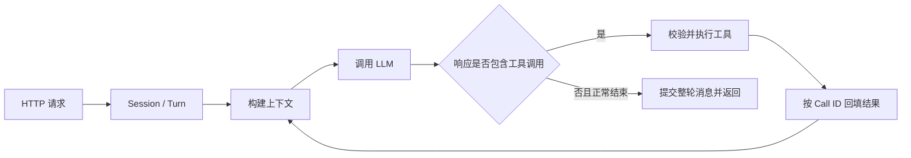

# mini-agent-go

使用 Go 标准库实现的最小 Agent Runtime。模型通过 OpenAI 兼容的 Chat Completions 协议决定直接回答或调用工具；运行时负责执行工具、回填结果、继续循环，并维护相互隔离的会话历史。

**技术栈：** Go 1.24 / `net/http` / OpenAI-compatible API / `log/slog`。业务模块无第三方依赖，不依赖现成 Agent 框架。

> 推荐访问 **[CNB 主仓库](https://cnb.cool/framework-station/mini-agent-go)**，获得代码阅读、云原生开发和构建记录的一体化体验。GitHub 为同步镜像，随 CNB `main` 更新自动同步。

## 当前能力

| 能力 | 当前状态 |
| --- | --- |
| Agent Loop | 支持直接回答、连续工具调用、单次响应包含多个工具调用；工具按顺序执行 |
| 工具注册与执行 | 名称、描述、JSON Schema 注册；执行前校验参数；处理超时、取消、重复 Call ID 与 panic |
| 内置工具 | 已实现 `calculator`、`mock_search`、`todo_create`、`todo_list`、`todo_complete`；**默认 HTTP 服务仅注册 `calculator`** |
| 会话与记忆 | 同会话连续对话、跨会话隔离；同会话请求串行，不同会话可并发；仅内存存储 |
| 上下文压缩 | 已有预算、窗口与工具消息配对保护的模块实现及测试；**默认 HTTP 服务未启用，生产摘要器尚未接入** |
| 运行保护与日志 | 模型/工具调用双预算、请求超时、失败整轮不提交；JSON 日志关联 Session、Run 和 Tool Call |
| 验证 | 自动化测试使用本地模拟模型；另有真实模型普通对话、计算器调用及错误响应的[验收记录](docs/verification.md) |

## 快速开始

### 在 CNB 云开发环境中运行

打开 [CNB 仓库](https://cnb.cool/framework-station/mini-agent-go)，启动云原生开发，在工作区终端操作。[`.cnb.yml`](.cnb.yml) 已配置开发镜像：

```text
docker.cnb.cool/arthur-cloud-native/jetbrains/goland:5.0.1
```

CNB 会拉取该镜像，并为开发环境提供 Docker 服务。进入仓库目录后：

```bash
make init
# 编辑生成的 .env，填写下表中的配置
make up
```

`make init` 创建 `.env`，已有文件会保留；`make up` 先检查配置，再构建应用镜像并启动服务。开发镜像的用途及本地准备方式见[运行指南](docs/running.md)。

### 在本机运行

需要 Git、Make、Docker、Docker Compose 和 curl，且 Docker 服务已启动。容器构建使用 Go 1.24，本机无需另装 Go。

```bash
git clone https://cnb.cool/framework-station/mini-agent-go.git
cd mini-agent-go
make init
# 编辑 .env
make up
```

两种环境都需要填写以下配置：

| `.env` 配置 | 填写内容 |
| --- | --- |
| `MINI_AGENT_LLM_BASE_URL` | 模型服务的兼容根地址，例如 `https://your-provider.example/v1`；不要带 `/chat/completions` |
| `MINI_AGENT_MODEL` | 服务商提供的模型 ID，需支持 Tool Calling |
| `MINI_AGENT_LLM_API_KEY` | 模型服务密钥 |
| `MINI_AGENT_AUTH_TOKEN` | 本服务的 HTTP 访问凭证，可用 `openssl rand -hex 32` 生成 |

`.env` 不提交到 Git。容器端口映射到当前环境的 `127.0.0.1:8080`；在 CNB 中，下列请求也在云开发终端内执行。

```bash
curl -sS http://127.0.0.1:8080/healthz
# {"status":"ok"}
```

健康检查只确认服务已启动，实际模型调用由下一步触发。首次构建需要拉取基础镜像；模型请求使用自己的 API Key，按服务商规则计费。

## 运行一次对话

以下命令在仓库根目录、同一个终端中依次执行。读取 `.env` 中的 HTTP 凭证，不输出其值；每次演示创建一个新会话。

```bash
HTTP_TOKEN="$(awk 'index($0,"MINI_AGENT_AUTH_TOKEN=")==1 {v=substr($0,23); sub(/\r$/,"",v)} END {print v}' .env)"
DEMO_SESSION="demo-$(date +%s)-$$"

curl -sS -X POST http://127.0.0.1:8080/v1/sessions \
  -H "Authorization: Bearer $HTTP_TOKEN" \
  -H 'Content-Type: application/json' \
  -d "{\"session_id\":\"$DEMO_SESSION\"}"

curl -sS -X POST http://127.0.0.1:8080/v1/chat \
  -H "Authorization: Bearer $HTTP_TOKEN" \
  -H 'Content-Type: application/json' \
  -d "{\"session_id\":\"$DEMO_SESSION\",\"message\":\"请使用计算工具计算 37 乘以 48。\"}"
```

已存档的真实调用返回了以下结果（节选，模型措辞和调用次数可能变化）：

```json
{"status":"COMPLETED","reply":"37 × 48 = **1776**","llm_calls":2,"tool_calls":1}
```

继续使用同一个 Session ID，验证工具结果进入了后续对话的上下文：

```bash
curl -sS -X POST http://127.0.0.1:8080/v1/chat \
  -H "Authorization: Bearer $HTTP_TOKEN" \
  -H 'Content-Type: application/json' \
  -d "{\"session_id\":\"$DEMO_SESSION\",\"message\":\"把刚才的结果加上 24，请继续使用计算工具。\"}"
```

预期算术结果为 `1800`。这是可手动验证的追问示例；现有真实模型验收记录覆盖普通对话和首次计算，同会话追问的历史回填另有自动化测试。使用另一 Session ID 会获得独立历史。

```bash
make logs   # 查看 run_started / llm_request / tool_finished 等 JSON 事件
make down   # 停止服务；内存会话随进程退出丢失
```

## 核心设计



**循环由模型响应驱动。** 工具名称、描述和参数 Schema 随请求发送；运行时解析 `content`、`tool_calls` 和 `finish_reason`，没有按用户输入关键词硬编码工具选择。只在正常结束时完成 Run；截断、协议异常和预算耗尽都有明确的失败结果。当前没有独立的思维链解析器。

**整轮提交。** 用户消息、模型回复和工具结果在同一个 Turn 中暂存，成功后一次提交；失败、取消或超限不会留下半轮历史。这个保证覆盖受管理的会话状态，不撤销外部工具已经发生的副作用。

**调用有界。** 模型调用和工具调用分别计数，在调用前检查额度，默认各最多 8 次。请求默认 60 秒超时；可恢复的工具错误作为结果回填模型，工具 panic 等不可恢复错误结束 Run。

入口与关键实现：[服务装配](service/runner.go) · [循环主体](agent/run.go) · [工具执行器](tool/executor.go) · [会话提交](session/manager.go)。完整取舍见[架构说明](docs/design/runtime-architecture.md)。

## Memory：何时读取，放在哪里

会话数据保存在进程内的 `session.Manager` 中，以 `session_id` 隔离。每轮开始取得该会话的 Turn 快照；**每次模型调用前**，上下文管理器把历史消息与本轮已产生的消息组成请求。用户消息、assistant 回复及带 `tool_call_id` 的工具结果都会参与后续对话。

逻辑顺序为 `System Prompt → 已有摘要（如有）→ 历史与当前消息`。System Prompt 单独经 Provider 接口传入，最终成为首条 system 消息；已有摘要紧随其后。当前采用会话历史回填，无向量检索或跨会话长期记忆。

压缩模块在估算超预算时将较早历史交给 `Summarizer`，保留近期消息，并把工具调用与对应结果视为不可拆分的单元。摘要与历史裁剪随成功 Turn 一起提交。**当前启动配置将预算固定为 0，摘要器为占位实现，因此上述压缩路径仅在模块测试中启用。**

## 测试与验证

本地直接运行测试需要 Go 1.24 或更高版本；竞态检查还需要工具链支持。

```bash
make ci   # build + vet + test + test -race
```

业务测试不调用真实模型，不需要 API Key；HTTP 测试会监听本机临时端口。已有测试覆盖循环、工具失败、会话隔离、历史回填、预算边界、取消/超时和压缩模块。

[验证说明](docs/verification.md)列出场景与对应测试，以及腾讯云 TokenHub / `deepseek/deepseek-flash` 的既有真实调用记录。离线集成测试注册了计算器与模拟搜索，和默认启动入口的工具集合不同，不能据此宣称所有工具已通过 HTTP 交付。

## 当前限制

- 默认服务只有计算器可调用；搜索与 Todo 的完整服务接入尚未完成。
- 默认服务不压缩上下文；长会话可能触达模型服务限制。
- Session 无持久化，默认不启用过期清理，重启后历史消失。
- 无流式输出、自动重试、用户账号体系或多实例状态共享。HTTP Bearer 是服务访问凭证，不代表按用户授权会话。

## 进一步阅读

| 文档 | 内容 |
| --- | --- |
| [运行指南](docs/running.md) | 开发镜像、本地二进制、容器操作、配置与故障排查 |
| [Runtime 架构](docs/design/runtime-architecture.md) | 调用链、会话一致性、工具执行、上下文与设计约束 |
| [HTTP API](docs/design/http-api.md) | 端点、字段、错误码及完整配置表 |
| [测试与验收](docs/verification.md) | 可重复测试、真实调用证据及验证边界 |
| [AI 辅助开发记录](docs/ai-assisted-development.md) | 提示词来源、实际问题、修复与验证依据 |
