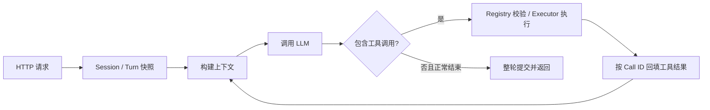

# mini-agent-go

从零实现的 Go Agent Runtime，核心执行循环不依赖现成 Agent 框架。模型通过 OpenAI-compatible Chat Completions / Tool Calling 决定回答或调用工具；运行时负责校验、执行、回填结果、继续循环与提交会话状态。

**技术栈：** Go 1.24 / `net/http` / `log/slog` / React + TypeScript。Go 业务模块仅依赖标准库。React 静态页面与 Go 后端打包成**一个应用镜像**，由同一个 Go 进程、同一个端口提供服务。

| 能力 | 当前实现 |
| --- | --- |
| Agent Loop | 直接回答、多步工具调用；单次响应可包含多个工具调用，按顺序执行 |
| 工具 | `calculator`、`mock_search`、`todo_create`、`todo_list`、`todo_complete` 均已接入正式启动入口；搜索使用固定数据集 |
| Session | 同会话多轮对话与串行执行、跨会话隔离与并发；状态仅保存在内存 |
| Context | 历史与工具结果回填、估算预算、近期窗口、规则化有损摘要；压缩默认关闭 |
| 运行保护 | 模型/工具调用预算、超时与取消、失败整轮回滚、关联 Session / Run / Tool Call 的 JSON 日志 |
| 对话页面 | 深浅主题、多会话、浏览器本地记录、Markdown；完整回答返回后显示，无流式输出 |

## 代码托管与开发方式

推荐访问 **[CNB 主仓库](https://cnb.cool/framework-station/mini-agent-go)**，代码阅读、云端开发与构建记录的体验更完整。CNB 是腾讯云推出的代码托管及云原生开发平台，提供 Git 仓库、流水线和云端开发能力，见[官方文档](https://docs.cnb.cool/zh/)。本项目使用 CNB 管理代码、配置云端开发和 Docker-in-Docker（DinD）构建环境，并通过 CI/CD 检查与发布应用镜像；配置见 [`.cnb.yml`](.cnb.yml)，执行结果以仓库构建记录为准。GitHub 为 CNB `main` 自动同步的镜像。

## 环境准备

### 方式 A：本地环境

两种启动模式都需要 **Git、GNU Make、Docker Engine / Docker Desktop、Docker Compose v2、curl**，以及可访问的 Docker daemon。预构建模式需要访问 CNB Registry；源码构建还需要拉取 Dockerfile 的基础镜像和 npm 依赖。

**体验应用无需在宿主机安装 Go 或 Node.js。** Docker 多阶段构建已提供 Go 1.24 和 Node.js 24。直接开发源码或在宿主机执行测试时，才需要 Go 1.24+（race 需要 C 工具链）和 Node.js 24。

当前正式镜像提供 `linux/amd64`，预构建模式会显式选择该平台。Apple Silicon 使用 Docker Desktop 的 AMD64 模拟支持；不具备模拟环境时选择本地构建，生成 Docker daemon 所在平台的镜像。

### 方式 B：可选开发容器

```text
docker.cnb.cool/arthur-cloud-native/jetbrains/goland:5.0.1
```

这是开发环境镜像，**不是正式应用镜像**。仓库的 CNB 云开发配置同时声明了 `vscode` 与 `docker` 配套服务，并检查 Docker / Compose。自行运行这个开发镜像时，仍需准备源码、Make、curl、Docker CLI、Compose，以及可访问的 Docker daemon / Socket；仅拉取镜像不会自动获得可工作的 DinD。具体依赖与访问位置见[运行指南](docs/running.md#开发容器与-docker-daemon)。

## 快速开始

```bash
git clone https://cnb.cool/framework-station/mini-agent-go.git
cd mini-agent-go
make init
```

选择启动方式，直接回车默认选 1：

1. **CNB 预构建镜像（推荐）**：每次 `make up` 拉取 `docker.cnb.cool/framework-station/mini-agent-go:latest`，不编译源码。
2. **当前源码本地构建**：每次 `make up` 使用根目录 Dockerfile 构建前端与 Go 后端，不需要另外启动 Node 服务。

编辑生成的 `.env`，填写**模型 API Key** 与**本服务 HTTP Bearer Token**。默认 BaseURL / Model 为作者已验收的 TokenHub 环境；如更换厂商，同时修改 BaseURL、Model、API Key。HTTP Token 可使用 `openssl rand -hex 32` 生成，两种凭证用途不同。

```bash
make up
```

成功后浏览器访问 **http://127.0.0.1:8080**。点击“试试计算器”，发送后再追问“把刚才的结果加上 24”；也可尝试创建、查询和完成 Todo。健康检查通过只代表应用可访问，实际模型可用性由对话验证。

启动模式保存在被 Git 忽略的 `.mini-agent-mode`，重新运行 `make init` 可切换；已有 `.env` 始终保留。非交互环境显式指定模式：

```bash
make init MODE=image
# 或 make init MODE=local
```

两个模式均只有一个应用容器，容器内固定监听 `0.0.0.0:8080`，默认仅映射宿主机 `127.0.0.1:8080`。CNB 云开发通过工作区的 8080 端口预览访问。`make init` / `make up` 不调用模型；发送聊天消息会使用配置的 Provider。

## HTTP API / curl

`/healthz` 免认证；`/v1/*` 需要 Bearer Token。浏览器使用同源 `/api/*`，凭证由 Go 服务内部注入，不进入前端产物或浏览器存储。

`.env` **不会自动成为当前 Shell 的环境变量**。以下命令在 **Bash、同一个终端**执行（zsh 用户先进入 `bash`），按提示粘贴 `.env` 中的 HTTP Token，输入不回显；不执行或 `source .env`。

```bash
curl -fsS http://127.0.0.1:8080/healthz
# {"status":"ok"}

set +x
read -r -s -p 'HTTP Token（与 .env 一致）: ' MINI_AGENT_AUTH_TOKEN
printf '\n'

curl -fsS -X POST http://127.0.0.1:8080/v1/sessions \
  -H "Authorization: Bearer $MINI_AGENT_AUTH_TOKEN" \
  -H 'Content-Type: application/json' \
  -d '{}'
```

复制返回的 `session_id`，继续：

```bash
read -r -p 'session_id: ' SESSION_ID

curl -fsS -X POST http://127.0.0.1:8080/v1/chat \
  -H "Authorization: Bearer $MINI_AGENT_AUTH_TOKEN" \
  -H 'Content-Type: application/json' \
  -d "{\"session_id\":\"$SESSION_ID\",\"message\":\"请使用计算工具计算37乘以48\"}"
```

成功响应为 JSON，包含 `status`、`reply`、`llm_calls` 与 `tool_calls`；预期算术结果为 `1776`，模型措辞及调用次数可能不同。用同一个 Session 追问：

```bash
curl -fsS -X POST http://127.0.0.1:8080/v1/chat \
  -H "Authorization: Bearer $MINI_AGENT_AUTH_TOKEN" \
  -H 'Content-Type: application/json' \
  -d "{\"session_id\":\"$SESSION_ID\",\"message\":\"把刚才的结果加上24，请继续使用计算工具\"}"

unset MINI_AGENT_AUTH_TOKEN SESSION_ID
```

预期算术结果为 `1800`。另一 Session 拥有独立历史；重启应用后需要重新创建 Session。

## 系统设计与 Memory



**Loop 与工具。** Registry 提供工具名称、描述和参数 Schema，随请求发给模型；运行时解析 `content`、`tool_calls` 和 `finish_reason`，由模型自主决定工具调用。Executor 校验参数、处理超时、取消、重复 Call ID 和 panic。没有按用户输入关键词硬编码工具选择，也没有独立的思维链解析器。

**召回时机与放置位置。** 每轮开始取得 `session_id` 对应的 Turn 快照；每次模型调用前，将已提交历史与本轮消息构造成上下文。逻辑顺序是 **System Prompt → Summary（如有）→ 历史与本轮消息**。用户输入、assistant 回复、工具调用及带 `tool_call_id` 的工具结果均可参与后续对话。System Prompt 成为首条 system 消息，Summary 紧随其后。

**基础压缩。** `MINI_AGENT_CONTEXT_TOKEN_BUDGET=0` 默认关闭压缩；设为正整数后，超出估算预算时对较早历史生成确定性的规则化有损摘要，保留 `MINI_AGENT_CONTEXT_KEEP_RECENT` 指定的近期消息下限。工具调用及其结果作为原子单元保留，不能拆散。摘要与裁剪后的历史随成功 Turn 提交；仍超预算时明确失败。它不调用额外模型，不是高级语义记忆，Token 估算也不是精确 tokenizer。

**Todo 与原子提交。** Todo 是 Session 内的结构化状态，通过当前 Turn 绑定的工具读写，不是向量数据库或 RAG。消息、Summary 和 Todo 修改在同一 Turn 暂存，成功后原子提交；失败、取消或预算耗尽时整轮丢弃。这个保证覆盖运行时管理的状态，不撤销未来外部工具可能产生的副作用。

**边界。** Session 仅在进程内存中，服务重启后不保留历史、摘要或 Todo。浏览器 localStorage 保存的是页面记录，不能恢复已丢失的服务端上下文。当前没有跨会话长期记忆、多实例状态共享或用户账号体系；HTTP Bearer 是服务访问凭证，不代表按用户授权会话。

关键实现：[启动装配](cmd/mini-agent/main.go) · [循环](agent/run.go) · [工具注册](service/tools.go) · [执行器](tool/executor.go) · [会话提交](session/manager.go) · [上下文](contextmgr/manager.go)。

## 测试与 AI 辅助开发

```bash
make ci        # Go build / vet / 单元与离线 E2E / race（含初始化与启动脚本测试）
make web-stage # Docker 中执行前端单元测试、类型检查和生产构建
```

Go 测试及离线 E2E 不调用真实模型；覆盖工具、会话隔离、Todo 与压缩联合提交/回滚、预算和错误分类。浏览器测试入口为 `npm --prefix web run test:e2e`，环境要求与既有 31 场景结果见[前端说明](web/README.md)和[测试与验收](docs/verification.md)。

TokenHub / `deepseek/deepseek-flash` 的既有真实模型证据、适用范围与局限保留在[测试与验收](docs/verification.md)。本次初始化与容器交付检查使用本地模拟 Provider，结果见[本次交付报告](docs/developer-onboarding-delivery.md)。AI Prompt 来源与实际问题修复记录见 [AI 辅助开发记录](docs/ai-assisted-development.md)。

## 其他命令

| 命令 | 用途 |
| --- | --- |
| `make init` | 创建或保留 `.env`，选择并保存启动模式 |
| `make check` | 检查模式、配置、Docker / Compose / curl 与 daemon，不调用模型 |
| `make up` | 按模式拉取或构建，启动单容器并检查容器状态、健康接口与页面 |
| `make down` | 停止并移除容器，保留本地配置与模式；服务端内存会话丢失 |
| `make logs` | 查看应用日志 |
| `make ps` | 查看容器状态 |
| `make ci` | Go 构建、静态检查、单元与离线 E2E、race |

进一步阅读：[运行指南](docs/running.md) · [Runtime 架构](docs/design/runtime-architecture.md) · [HTTP API 与配置](docs/design/http-api.md)。
